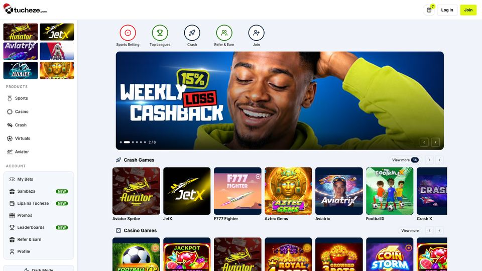
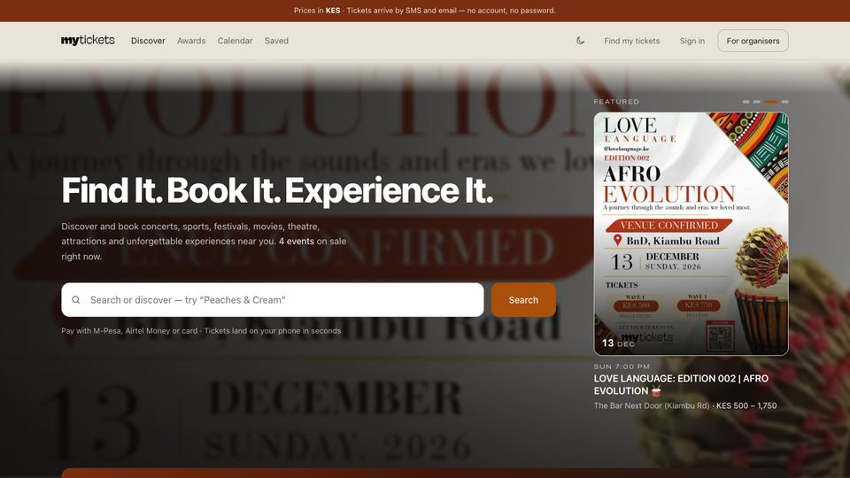
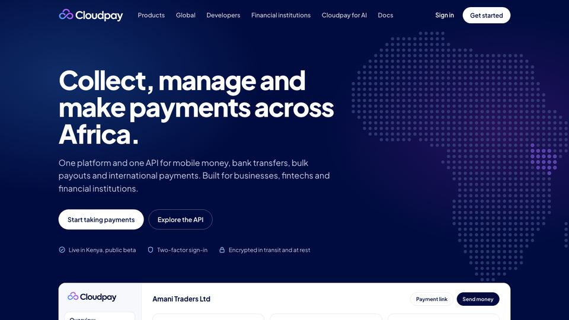
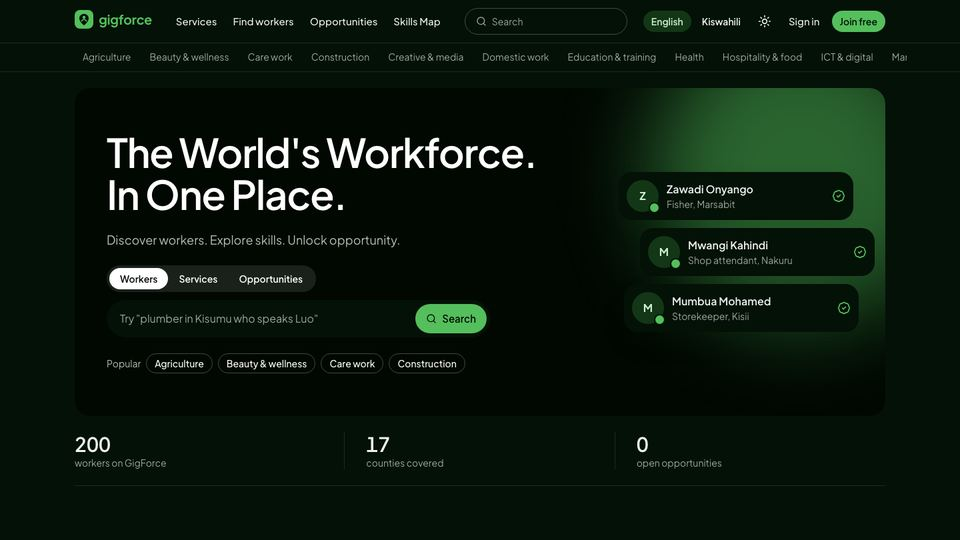

# Arnold Musandu

**Platform / Backend Engineer** in Nairobi. I build and run high-traffic systems: betting, ticketing, payments, and AI-backed learning tools.
I care about systems that are fast, observable, cost-efficient, and **boring in production**.

  

<a href="https://claude.ai/artifact/P572fkpkEJeSm8n8JAx7A7"><b>↗ Explore the interactive system map</b></a>

---

## Things I help run

<table>
  <tr>
    <td width="50%" align="center">
       
      <b><a href="https://tucheze.com">Tucheze</a></b> · betting, 1M+ players
    </td>
    <td width="50%" align="center">
       
      <b><a href="https://mytickets.africa">MyTickets</a></b> · event ticketing
    </td>
  </tr>
  <tr>
    <td width="50%" align="center">
       
      <b><a href="https://cloudpay.africa">CloudPay</a></b> · payments across Africa
    </td>
    <td width="50%" align="center">
       
      <b><a href="https://gigforce.africa">GigForce</a></b> · workforce marketplace
    </td>
  </tr>
  <tr>
    <td width="50%" align="center">
       
      <b><a href="https://faidabet.co.ke">FaidaBet</a></b> · betting &amp; games
    </td>
    <td width="50%" align="center">
       
      <b><a href="https://propertyms.org">PropMS</a></b> · property management
    </td>
  </tr>
</table>

## Campus Connect: AI learning platform (200+ students)

A study platform with AI that reads your documents, P2P file sharing, and an LLM layer that stays up when a provider goes down.

## Earlier

**Savannah Informatics** (healthcare): sped up NX monorepo CI and led the Keycloak auth migration · Angular · TypeScript · NX

---

## Open source

* **[graphindex](https://github.com/254binaryninja/graphindex)**: a lightweight Go MCP server that indexes codebases so AI coding agents can navigate them faster and cheaper
* **[ngao-kijani](https://github.com/254binaryninja/ngao-kijani)**: open-source ESG tooling
* **[Daily Bible API](https://github.com/254binaryninja/daily-bible-api)**: a REST API serving structured scripture
* **[NSE Data Pipeline](https://github.com/254binaryninja/project-soko-data)**: ingestion and processing for the Nairobi Stock Exchange

## Toolbox

* **Backend**: Go, Python, TypeScript/Node, Bun · PostgreSQL, MongoDB · REST, gRPC
* **Infra**: Docker, Kong, DigitalOcean, GCP, Cloudflare · GitHub Actions, GitLab CI · zero-surprise migrations
* **AI**: Vercel AI SDK, RAG, Pinecone, multi-provider LLM routing, MCP
* **Frontend (when needed)**: React, Next.js, Angular

## Learning deeply

PostgreSQL internals & query planning · schema design under load · Java & Spring Boot · container orchestration

## Education

**BSc Economics & Statistics**, Kenyatta University *(expected 2027)*

---

Building **developer tools, platform infrastructure, or data-heavy systems**? Let's talk.
[arnoldmusandu@gmail.com](mailto:arnoldmusandu@gmail.com) · [LinkedIn](https://www.linkedin.com/in/arnold-musandu-3489b2293/) · Nairobi, Kenya

> *Systems that scale, and stay sane in production.*
